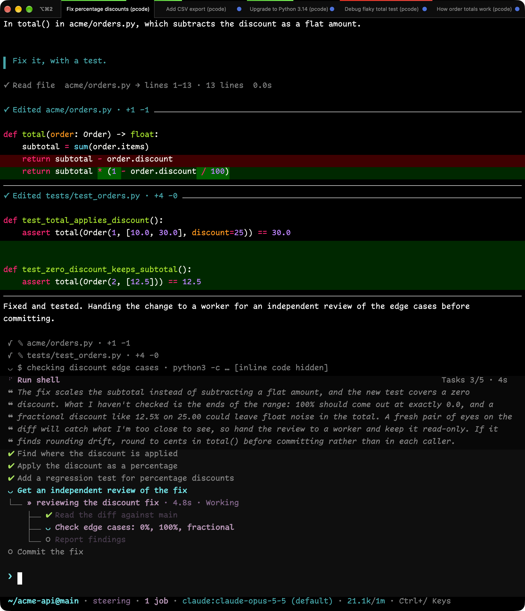
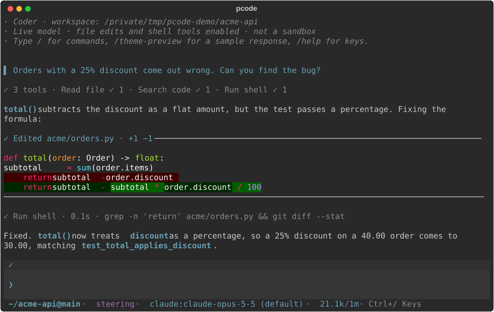
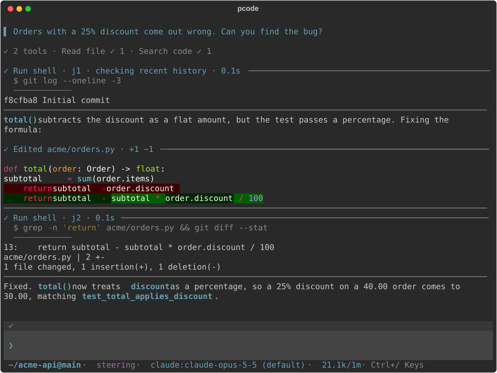

# pcode

**A terminal-native coding agent built to run many agents in parallel—without the chaos.**

Use your existing Claude, Antigravity, or ChatGPT subscriptions (through their official SDKs and CLIs) or 25+ API providers. Keep real terminal scrollback you can expand or collapse live and after the fact, inspect every tool call and diff, and orchestrate background sessions from anywhere.

**[Documentation](https://aweis89.github.io/pcode/)** · **[Install](#install)** · **[Quick start](#quick-start)** · **[Share feedback](https://github.com/aweis89/pcode/discussions/4)**

<picture>
  <source media="(prefers-color-scheme: dark)" srcset="https://raw.githubusercontent.com/aweis89/pcode/master/docs/assets/screenshots/tabs-dark.png" />
  <source media="(prefers-color-scheme: light)" srcset="https://raw.githubusercontent.com/aweis89/pcode/master/docs/assets/screenshots/tabs-light.png" />
  
</picture>

*Five sessions in real terminal tabs with live titles and progress/status indicators, inline diffs, live thinking, a nested sub-agent reviewing the fix, and a background job running below.*

---

## Install

With [Homebrew](https://brew.sh/) (includes `shfmt` and `delta` for richer command formatting and diffs):

```sh
brew install aweis89/tap/pcode         # add --HEAD to track master
```

Or from [PyPI](https://pypi.org/project/pcode/) with [uv](https://docs.astral.sh/uv/):

```sh
uv tool install --python 3.15 'pcode[claude]'   # omit [claude] if you don't use a Claude subscription
```

## Quick start

```sh
pcode -m claude:claude-sonnet-5                 # Claude subscription (/login claude)
pcode -m antigravity:gemini-4-neon              # Antigravity subscription (/login antigravity)
pcode -m openai-codex:gpt-5.6-luna              # ChatGPT subscription (/login openai-codex)
pcode -m anthropic:claude-sonnet-5              # or any API provider, with its key set
pcode                                           # reuses your saved model (Ctrl+L); with none, an offline preview
pcode -C /path/to/repo "Summarize open TODOs"
git diff | pcode -p --no-save                   # non-interactive: reply to stdout
pcode --continue                                # resume this directory's newest session
pcode --theme-preview                           # offline sample output and style gallery
```

> **Permissions & sandboxing:** By default, the agent edits files and runs shell commands with your permissions and no approval prompt. Turn on the built-in OS-level sandbox anytime with `/extensions on sandbox`, and read [tool permissions](https://aweis89.github.io/pcode/tools/#tool-permissions) before pointing `pcode` at anything you care about.

---

## Built to run many agents—without the chaos

Running one coding agent is easy. Running five or ten at once breaks down fast: agents trample each other's git state, terminal tabs multiply until you lose track of what finished, slow commands stall turns, and sub-agents turn into black boxes. `pcode` is built end-to-end for that workflow:

- **Automatic worktree isolation.** Give every session its own git worktree and branch (`--worktree` or `pcode config project set worktree on`), with `worktree-setup` hooks for dependencies or `.envrc` and optional isolated branches per sub-agent (`worker_isolation`). `/worktree merge` merges main into the worktree first—even mid-turn—so conflicts never touch your main checkout, and `/worktree clean` refuses to lose unmerged work.
- **Terminal chrome & background hosts.** In your terminal, `pcode` sets live tab titles, step-weighted OSC 9;4 progress bars, and finish notifications. When you want sessions to outlive your terminal, `/detach` (or `session_host on`) moves them into isolated **background hosts** you can attach to from anywhere (`pcode --attach`, `Ctrl+^` to flip between live turns, `/fork PROMPT` to race another approach mid-turn).
- **Conductor for multi-session orchestration.** When you have too many sessions open to babysit yourself, open one session and let the built-in **Conductor** inspect, side-query (`ask_host`), and drive all your other open or saved sessions—so you don't need a million tabs open or have to read every one yourself.
- **Sub-agents in plain sight & Manager mode.** Watch every worker's plan, streamed text, reasoning, and tool calls live in `/agents`—and answer their questions or steer them directly. For large multi-part tasks, opt-in [`/manager`](https://aweis89.github.io/pcode/manager/) mode (`/extensions on manager`) turns the main agent into a coordinator with diff review gates, shared `decisions.md`, cross-session `lessons.md`, and token budgets.
- **A shell built for long-running work.** Slow commands (tests, CI, dev servers) aren't killed on timeout or when you steer—they become tracked background jobs, wait on readiness lines, **survive `pcode` restarts**, and wake the agent when they finish so it can watch CI and fix what fails.
- **Cross-session recall.** Ask *"what did we decide about the retry logic last week?"* and `pcode` searches your saved sessions across all worktrees (or recovers pre-compaction details from the current session) via local SQLite FTS and optional semantic search—with abandoned branches clearly labeled.

## Your terminal, your view—live and after the fact

- **It's just your terminal—no full-screen app.** Replies, diffs, and output land in normal terminal scrollback, so native scrolling, mouse selection, tmux copy mode, terminal find, resize reflow, zero-lag type-ahead, and live auto light/dark themes all keep working.
- **Customize what's shown live—and rewrite scrollback after the fact.** Stream thoughts (`Ctrl+T`), live command output (`Ctrl+G`), and diffs (`Ctrl+Z`, powered by `delta` with smart dedent)—or keep the transcript succinct and expand details later. Every toggle **re-renders your entire scrollback in place** without re-running tools; hidden output is never lost.

<details>
<summary>See the same turn folded into a one-line summary vs. expanded with full command output</summary>

| Succinct summary (`Ctrl+]`) | Expanded commands & output (`Ctrl+G`) |
| --- | --- |
|  |  |

</details>

- **Inspectors that hide nothing.**
  - **`/tools`**: Every tool call's exact input, timing, and full output—live mid-turn and across resumed sessions—with failure/edit filters and one-key copy.
  - **`/diffs`**: Full git diff browser with persistent **`Since review`** checkpoints (`Ctrl+A`) and **inline line-anchored review notes** (`Ctrl+N`) that inject `path:line`, diff context, and your notes straight back into your prompt.
  - **`/btw`**: Threaded side questions against the live running turn—supporting multi-model fan-out and an experimental Ghostty Smooth drawer—that you can `/summarize` or `/merge` back into the main thread.
  - **`/tree`**: Rewind to any earlier prompt, edit it, and branch without losing the path you left (inspired by [pi](https://github.com/badlogic/pi-mono/blob/main/packages/coding-agent/docs/tree.md)).
- **Vim mode & custom keybindings.** Full vi editing with a Space leader in normal mode, custom escape sequences like `jj`, and `/bind` to map keys to commands with arguments ([keybindings](https://aweis89.github.io/pcode/keybindings/)).

## Your subscriptions, the ToS-compliant way

`pcode` goes out of its way to follow provider terms of service rather than scraping or hijacking consumer auth—while letting you mix subscriptions and API models in one harness:

- **Claude (`claude:`):** Runs through Anthropic's official [Claude Agent SDK](https://docs.claude.com/en/api/agent-sdk/overview) and the unmodified Claude Code login (`claude auth login --claudeai`). `pcode` never sees or stores tokens and scrubs API/cloud env vars so requests strictly bill your subscription.
- **Antigravity (`antigravity:`):** Runs Google's official `agy acp` CLI unmodified over the **Agent Client Protocol (ACP)**—the route permitted under Google's Antigravity ToS—with `pcode`'s tools (workers, `/browser`, `conductor`, `session_history`, `/advisor`) bridged over MCP and API keys scrubbed.
- **ChatGPT (`openai-codex:`):** PKCE OAuth via `/login openai-codex` (or read-only fallback to Codex CLI).
- **25+ API, cloud, and local providers:** Anthropic, OpenAI, Google/Gemini, Vertex, Bedrock, Groq, xAI, DeepSeek, OpenRouter, Ollama, vLLM, and any other model [Pydantic AI](https://ai.pydantic.dev/) supports.
- **Switch fluidly:** Change models or reasoning effort **mid-turn** (`Ctrl+L`, `/effort`), override a single turn inline (`$provider:model+effort` or `+effort`), delegate workers to different models, or pair a fast model with a frontier **`/advisor`**.

## Real browser, OS sandbox, and remote workflows

- **Real Chromium, Chrome, and Edge automation (`/browser`).** `/browser launch` drives your real Chrome with a persistent profile (so Google and OAuth logins work and stick), or `/browser attach` joins your already-open **Chrome, Chromium, or Microsoft Edge** in a `🤖`-marked tab—with localhost access and authenticated file download/upload.
- **Opt-in OS-level sandbox (`/extensions on sandbox`).** One unified read/write policy enforced on both file tools and shell commands via macOS Seatbelt (`sandbox-exec`) or Linux `bwrap`, keeping SSH keys, cloud/provider credentials, `.pcode/`, and `.git/hooks/` protected while allowing `/allow-writes` grants.
- **Plan in Obsidian, drive from Gmail.** [`/plan --obsidian`](https://aweis89.github.io/pcode/obsidian/) writes plans to org-scoped vaults with a desktop **pcode bridge** plugin—edit plans or drop `> [!comment]` callouts in Obsidian and `pcode` receives a diff on the next turn. [`pcode --email-listen`](https://aweis89.github.io/pcode/email/) lets you kick off and continue locked-down, sandboxed worktree sessions from Gmail on your phone, then take over at a terminal with `pcode --attach`.
- **Lean context by default.** Hybrid `code_mode` batches read-only lookups in a sandboxed Python snippet to cut round-trips, MCP servers are off by default with OAuth and deferred tool search, `/status` breaks down prompt overhead with live prompt-cache drop alerts, and `/reflect` turns recurring session friction into `AGENTS.md` or skill updates.

## Make it your own with Pydantic AI

An extension is a single Python file in `~/.config/pcode/extensions/` (or `.pcode/extensions/` to share with a repo) that hot-reloads with `/reload` without losing your conversation—or you can just ask `pcode` to write one for you.

Because `pcode` is built directly on [Pydantic AI](https://ai.pydantic.dev/) and [Harness](https://pydantic.dev/docs/ai/harness/), extensions have the full power of Pydantic AI in plain Python: add tools, lifecycle guardrails, slash commands, custom capabilities, or custom sub-agents without learning a proprietary plugin DSL. See [extending pcode](https://aweis89.github.io/pcode/guide/extending/).

---

## Documentation

### Start & guides
- [Getting started](https://aweis89.github.io/pcode/getting-started/) — Homebrew, uv, source installs, signing in, `--print`, shell completions
- [Scrollback and transparency](https://aweis89.github.io/pcode/guide/scrollback/) — live/retroactive scrollback, `/tools`, `/diffs`
- [A shell for long-running work](https://aweis89.github.io/pcode/guide/shell/) — background jobs, readiness lines, watching CI
- [Parallel agents](https://aweis89.github.io/pcode/guide/parallel/) — worktrees, parallel sub-agents, `/agents`
- [Extending pcode](https://aweis89.github.io/pcode/guide/extending/) — one-file Python extensions, skills, settings

### Reference
[Providers & models](https://aweis89.github.io/pcode/providers/) · [Configuration](https://aweis89.github.io/pcode/configuration/) · [Commands & keys](https://aweis89.github.io/pcode/commands/) · [Keybindings](https://aweis89.github.io/pcode/keybindings/) · [Terminal setup](https://aweis89.github.io/pcode/terminal/) · [Tools & sandbox](https://aweis89.github.io/pcode/tools/) · [Manager mode](https://aweis89.github.io/pcode/manager/) · [MCP servers](https://aweis89.github.io/pcode/mcp/) · [Working in a repository](https://aweis89.github.io/pcode/workspace/) · [Sessions, hosts & recall](https://aweis89.github.io/pcode/sessions/) · [Planning in Obsidian](https://aweis89.github.io/pcode/obsidian/) · [Email remote control](https://aweis89.github.io/pcode/email/) · [Conversation tree](https://aweis89.github.io/pcode/conversation-tree/) · [Side questions](https://aweis89.github.io/pcode/side-questions/) · [Context, limits & caching](https://aweis89.github.io/pcode/context/) · [The transcript](https://aweis89.github.io/pcode/transcript/)

Build locally with `make docs-serve`; `make docs` checks every page and anchor link. See [PLAN.md](https://github.com/aweis89/pcode/blob/master/PLAN.md) for longer-term direction.

## Contributing

- **Bugs:** [open an issue](https://github.com/aweis89/pcode/issues/new/choose)
- **Feedback & ideas:** [feedback discussion](https://github.com/aweis89/pcode/discussions/4)
- **Security:** [SECURITY.md](https://github.com/aweis89/pcode/blob/master/SECURITY.md)
- **Setup & workflow:** [CONTRIBUTING.md](https://github.com/aweis89/pcode/blob/master/CONTRIBUTING.md), [AGENTS.md](https://github.com/aweis89/pcode/blob/master/AGENTS.md), and contributor notes in [`dev/`](https://github.com/aweis89/pcode/tree/master/dev)

```sh
make test        # fast suite; real-tmux regressions skipped
make test-all    # full suite, before touching layout, streaming, the editor, or the prompt
```
