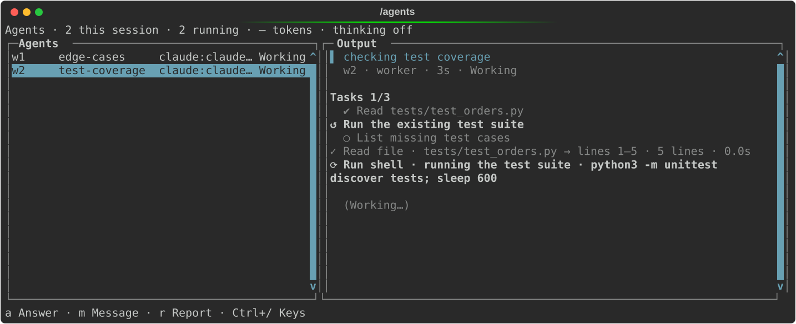

# Parallel agents

pcode is built for running more than one agent at a time: several sessions on
the same repository, and sub-agents fanning out inside a single session. Two
things make that workable: each agent gets its own checkout so they don't
collide, and you can see what every one of them is doing.

## Several sessions on one repo

Two agents in one checkout step on each other. One runs `git checkout` or
`git stash`, and the other's uncommitted edits are gone. Turn on worktrees and
every session gets its own git worktree and branch under `.worktrees/`, which
becomes its workspace:

```sh
pcode config project set worktree on   # every session in this repo
pcode --worktree fix-flaky-test        # or just this one, with a readable name
```

File tools, the shell and the saved session all point at the worktree, so the
agent needs no instructions to stay out of your main checkout. Now you can have
one session fixing a bug, another building a feature and a third reviewing a
PR, all at once.

When a session's work is ready:

- `/worktree` shows the branch and what isn't merged yet.
- `/worktree merge` merges your main branch into the worktree first, so any
  conflicts are resolved there and never in your main checkout, then
  fast-forwards main. It works mid-turn for work the agent already committed.
- `/worktree finish` merges, removes the worktree and quits. Leaving a session
  with unmerged commits asks what to do (`worktree_exit` can make it always
  merge or always keep).
- `/worktree clean` removes finished worktrees, and lists any it kept and why,
  so it can't lose work.

New worktrees don't have your dependencies or untracked config. A
`worktree-setup` script runs in each new one to install dependencies or copy
files like `.envrc`. See
[one git worktree per session](../workspace.md#one-git-worktree-per-session).

### Sessions keep running when you look away

`/detach` moves a session into a background host, or `pcode --host` starts it
in one, so you can juggle several from one terminal. `/attach` moves to another
running session, `/new PROMPT` starts one, `/fork PROMPT` branches a copy of
the current conversation onto another approach in its own worktree, and Ctrl+^
flips back to the last one. Closing the terminal doesn't stop a hosted turn;
`pcode --attach` picks it back up, and you get a desktop notification when a
background session finishes. See
[background sessions](../sessions.md#background-sessions).

### Orchestrating many sessions: Conductor

Once you have several background hosts running, you don't need to hop between
tabs to check on them. Open one session and ask it to coordinate the rest: the
built-in **Conductor** gives the agent `list_hosts`, `inspect_host`,
`ask_host` (a side query against another session's full context without
interrupting its turn), `send_to_host`, `wait_for_hosts`, and `stop_host`.
That lets one session fan out prompts across multiple worktrees, collect status
or answers, and wait for them to finish. See
[conductor](../sessions.md#conductor-orchestrating-other-sessions).

## Sub-agents in parallel

Inside one session, the agent can hand self-contained tasks to **workers**:
sub-agents with the same tools, each starting from a clean context with its own
plan. Several run at once. Ask for work that splits naturally:

```text
❯ add input validation to the three API handlers, one worker per handler
❯ investigate why each of these four tests is flaky and report back
```

Workers also keep the main conversation lean: the parent only gets each one's
result, so the files a worker reads and the output of its commands never fill
the session's context. There is no limit on how many run at once unless you
set `worker_concurrency`.

### See what every agent is doing: `/agents`

Sub-agents in most tools are a black box until they return. In pcode, the task
panel lists each running agent beneath your task with its purpose, and
`/agents` opens a live view of all of them, even mid-turn:

- each agent's assignment and its own task plan
- what it's writing, streamed as it goes
- every tool call it makes
- its reasoning, with Ctrl+T



From `/agents`, press **`a`** to answer a worker's question directly, **`m`**
to send a steering message before its next step, or **`r`** to read its full
report ([talking to workers](../tools.md#talking-to-workers)). Workers' tool
calls also show under the parent's in scrollback and in `/tools`.

### Agents on other models

By default sub-agents run on the session's model. Name another model in your
request ("ask openai-codex:gpt-6-astra for a second opinion") and the sub-agent
runs on it. `/subagents` gives the agent a standing list of models to pick
from, for example a cheaper, faster model for mechanical changes, or a
different vendor for a second opinion:

```text
❯ /subagents openai-codex:gpt-6-astra anthropic:claude-sonnet-5
```

If you want a second opinion from a stronger model *without* delegating a whole
tool-using worker, use [`/advisor`](../providers.md#advisor) instead—it advises
the main agent on the current context without running tools of its own.

### Agents in their own worktrees

Agents share the session's checkout by default, which is right for
investigation and small edits. For parallel editing, turn on
`worker_isolation` alongside `worktree`. Each agent then works on its own
branch starting from the session's current commit, and its result comes back
as a branch to review and merge in, never straight into your work:

```sh
pcode config project set worktree on
pcode config project set worker_isolation on
```

See [sub-agents](../tools.md#sub-agents-on-other-models) and
[worker worktrees](../tools.md#worker-worktrees).

### Let the agent coordinate: `/manager`

For a task big enough to need several workers, `/manager` turns the main agent
into a coordinator: it splits the work, briefs each worker, runs diff review
gates before ticking off a step, tracks shared contracts in `decisions.md` and
cross-session `lessons.md`, and enforces token budgets so a runaway loop can't
burn through your quota. It's opt-in (`/extensions on manager`). See
[manager mode](../manager.md).
